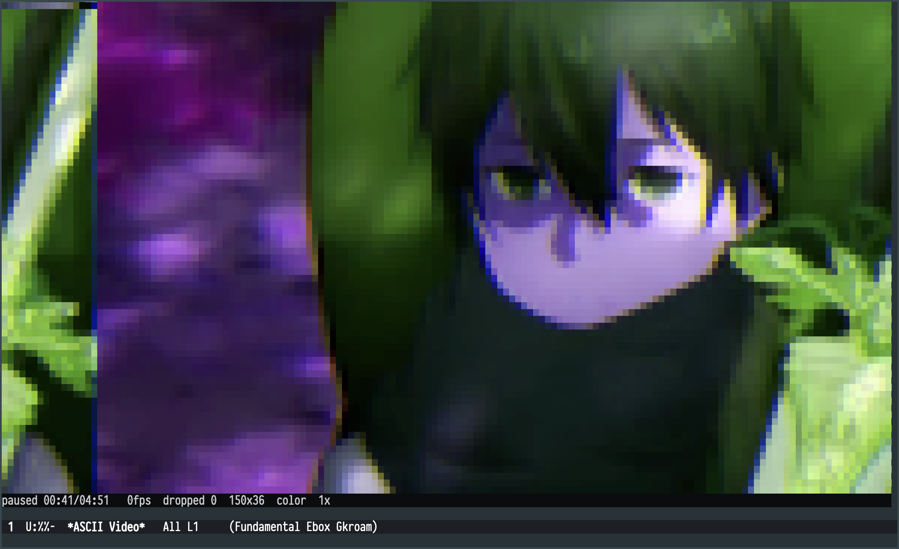

# ETAF ASCII Video

ETAF ASCII Video shows a local video or HTTP(S) stream inside an Emacs buffer
as pure characters, in the two character render modes of ETAF's native
`etaf-video` Component: a density ramp (one character per pixel) and true-color
half blocks (`▀`, two full-color pixels per cell). The native Component decodes
with ffmpeg and publishes every frame through
[ETAF](https://gitea.vhkd.top/geekinney/etaf)'s retained content boundary, so
one displayed frame is one incremental publication of a fixed canvas Host, not
a full re-render. This application owns the buffer, the fitted canvas size,
the render mode, the status line and the keys. For the sharp, full-window
image player with sound, use the companion `etaf-video-player`.

A local video playing as true-color half blocks:



## Capabilities

- Playback of local video files through ffmpeg; the built-in demo generates a
  test pattern with ffmpeg's `lavfi` input, so no file is needed.
- HTTP(S) video URLs play as streams: ffmpeg decodes them directly, nothing is
  downloaded first, and a dropped connection is retried for five seconds.
- Two character render modes. The default monochrome mode maps each pixel to
  one density-ramp character. True-color half-block mode (`c`) renders two
  full color pixels per character cell with `▀` (top pixel as foreground,
  bottom as background), keeping the video's colors at double the vertical
  resolution.
- A canvas that fits the window (and follows resizes), four grid presets, and
  explicit `etaf-ascii-video-set-grid` for scripts.
- Play, pause, single frame stepping, seeking, and 0.5x to 8x rates.
- Latest-frame-wins display: when decoding outruns display, older frames are
  dropped instead of replayed as a backlog.
- `etaf-ascii-video-state` exposes the live player as plain data for scripts
  and tests.

## Prerequisites

| Requirement | Why | Check |
| --- | --- | --- |
| Emacs 29.1 or newer | the ETAF runtime | `emacs --version` |
| `etaf`, `ebox`, `ecss` | the framework; each root entry must be on `load-path` | every checkout is readable |
| ffmpeg | decoding and downsampling | `ffmpeg -version` |
| ffprobe | duration, frame rate and video size | `ffprobe -version` |

ffprobe is optional: without it playback uses the source defaults for
dimensions and rate and the status line shows no total duration.  The decoder
programs, the density ramp and the display rate are the `etaf-video-*`
variables documented in ETAF's manual.

## Installation

```elisp
(add-to-list 'load-path "/path/to/ecss")
(add-to-list 'load-path "/path/to/ebox")
(add-to-list 'load-path "/path/to/etaf")
(add-to-list 'load-path "/path/to/etaf-ascii-video")
(require 'etaf-ascii-video)

(global-set-key (kbd "C-c a") #'etaf-ascii-video-open-file)
```

## Minimal example

```elisp
(etaf-ascii-video-demo)                 ; generated test pattern, no file
(etaf-ascii-video-open-file "clip.mp4") ; a local video
(etaf-ascii-video-open-url "https://example.com/clip.mp4") ; a network stream
(etaf-ascii-video-open '(:file "clip.mp4" :columns 120 :rows 34 :speed 2))
(etaf-ascii-video-open '(:file "clip.mp4" :mode 'color))  ; half-block color
```

## Keys

| Key | Action |
| --- | --- |
| `SPC` | play or pause |
| `n` | pause and present one more frame |
| `f` / `b` | seek five seconds forward or backward |
| `+` / `-` | raise or lower the playback rate |
| `1` .. `4` | grid presets (64, 96, 128, 176 columns, rows follow the aspect) |
| `c` | toggle true-color half-block rendering |
| `F` | fit the canvas to the window |
| `o` / `u` / `d` | open a file / open a URL / replay the built-in demo |
| `?` / `q` | help / close |

## Checks

```sh
make check    # structure + byte compilation (warnings as errors) + acceptance + API boundary
make test     # the public acceptance scenarios only
```

The acceptance suite drives the repository's fake ffmpeg and ffprobe fixtures,
so it needs no real decoder, no network and no frame; one scenario runs the
real ffmpeg when one is installed.

## Documentation

- [The manual](docs/manual.md): playback, canvas fitting, scripting, variables
  and troubleshooting.
- [Architecture](docs/architecture.md): module responsibilities, data flow,
  invariants and the ownership boundary with ETAF.
- [The root entry Commentary](etaf-ascii-video.el): the authoritative list of
  supported functions and variables.
